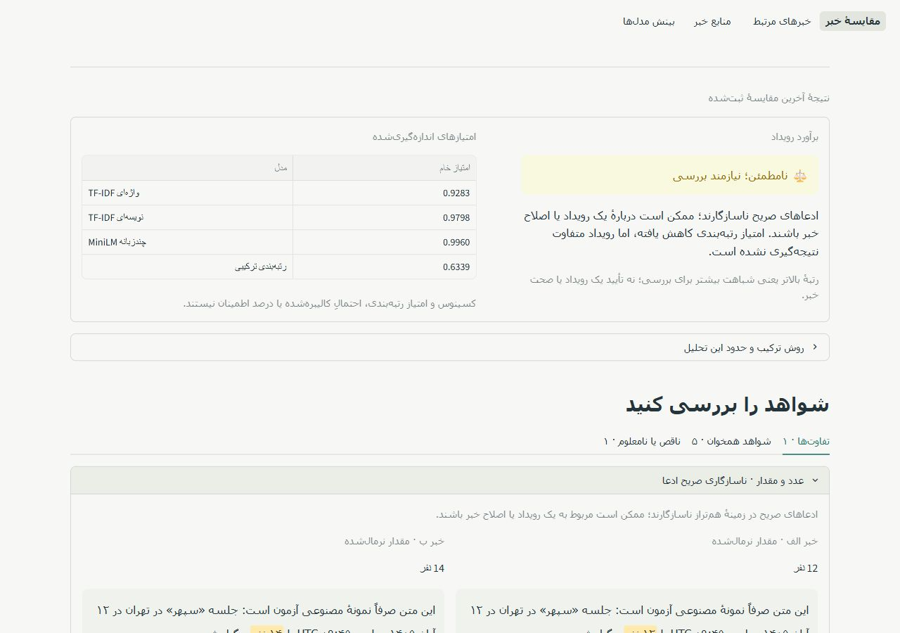
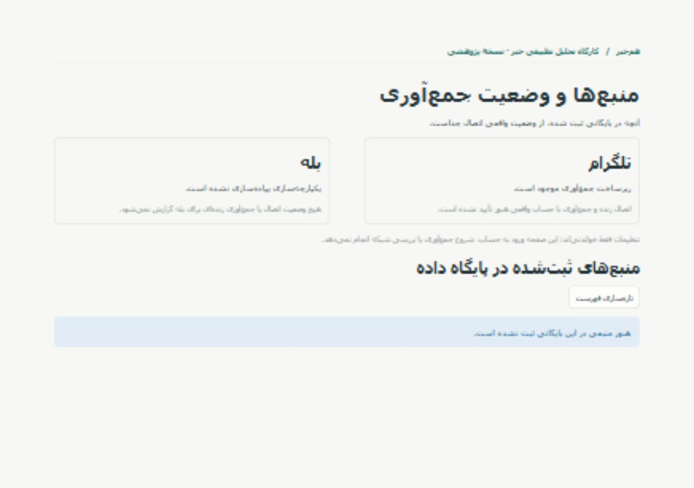
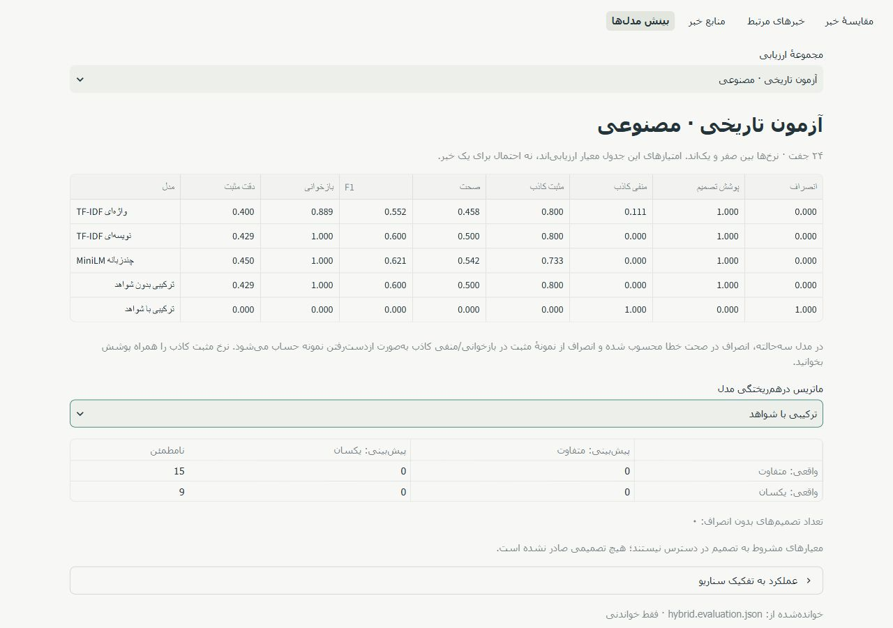

# Phase 1.5: Persian Streamlit analysis workspace

Implemented and verified on 2026-10-28 with Python 3.12.14 and Streamlit 1.66.1.
The application is functional and uses the existing frozen services. No models,
thresholds, evaluation datasets or previous benchmark results were changed.

## Scope and changed files

| File or group | Change |
| --- | --- |
| `src/news_similarity/ui/app.py` | Persian application shell, top navigation, wide layout and small RTL style sheet |
| `src/news_similarity/ui/runtime.py` | Construct the UI facade without loading models |
| `src/news_similarity/ui/presentation.py` | Persian labels, timestamps and explanatory presentation text |
| `src/news_similarity/ui/pages/comparison.py` | Manual input, optional source metadata, explicit inference, results and JSON download |
| `src/news_similarity/ui/pages/explorer.py` | Paginated archive, stored-news selection, cross-source filters and ranking |
| `src/news_similarity/ui/pages/sources.py` | Recorded source statistics and honest, read-only integration status |
| `src/news_similarity/ui/pages/insights.py` | Dataset-separated measured benchmarks, confusion matrices and abstention explanations |
| `src/news_similarity/ui/components/news_card.py` | Escaped original text, publication time and safe optional links |
| `src/news_similarity/ui/components/score_display.py` | Actual scores, unchanged decisions and frozen fusion details |
| `src/news_similarity/ui/components/evidence_panel.py` | Matching/conflicting/unknown evidence and highlighted original spans |
| `src/news_similarity/ui/services/ui_facade.py` | Input validation, read-only repository adapter and inference orchestration |
| `src/news_similarity/ui/services/resources.py` | Lazy CPU model resource cache and inference lock |
| `src/news_similarity/ui/services/benchmarks.py` | Read and validate actual evaluation artifacts without rerunning evaluation |
| `src/news_similarity/ui/**/__init__.py` | Optional UI package boundaries |
| `src/news_similarity/database/repository.py` | Additive SQLite read-only option and reusable archive/source queries |
| `tests/test_ui_services.py` | Service, read-only storage, ranking, artifacts, input and evidence tests |
| `tests/test_ui_app.py` | Streamlit AppTest page, form, cache, error and score-propagation tests |
| `scripts/create_ui_demo_archive.py` | Explicit separate demo from existing synthetic fixtures, refusing overwrites |
| `.streamlit/config.toml` | Local-only server address, restrained theme and disabled usage telemetry |
| `pyproject.toml` | Optional `ui` extra pinned to tested Streamlit 1.66.1 |
| `README.md` | Installation, normal launch, optional synthetic demo and limitations |
| `docs/PHASE_1_5_REPORT.md` | This report |
| `docs/images/phase15-comparison.jpg`, `phase15-sources.jpg`, `phase15-insights.jpg` | Actual browser screenshots |

All prior automated tests remain present. The repository change is additive:
existing callers retain their previous write-capable behavior. The UI explicitly
requests read-only connections and never calls database initialization or
collection functions. No database schema migration was added.

## Architecture and loading

The Streamlit pages call `UiFacade`, which wraps existing `NewsRepository`
queries and `HybridMatcher.compare()` / `.rank()`. Feature extraction,
preprocessing, lexical scoring, semantic inference and event decisions remain
in their existing implementations. The UI imports no CLI internals.

The facade does not load MiniLM during page navigation, database browsing,
benchmark viewing or text edits. Submission of the comparison/search form
requests a cached resource. Existing lexical artifacts, semantic freeze and
hybrid freeze are validated by `load_hybrid_matcher()`. MiniLM uses CPU and
`local_files_only=True`; the interface neither downloads nor retrains models.

`st.cache_resource` keys the resource on configuration and artifact modification
identity, with a bounded two-entry cache. A lock serializes access to the
existing mutable embedding LRU across Streamlit sessions. Individual results
remain in session state. No database sessions are retained across UI actions.
The app is a local research tool, not an authenticated multi-tenant deployment.

Expected loading, file, configuration and database errors are presented in
Persian without private exception payloads or invented fallback scores. Empty
input is rejected before requesting any model. A failed submission clears the
previous comparison view; retained views are labeled as the last submitted
analysis. Editing a form does not silently run another inference.

## Pages and behavior

### News comparison

Two Persian text areas and optional source names/links form the primary
workspace. Source metadata is explicitly user supplied and does not influence
the model. Inputs preserve original text; blank/formatting-only content and
invalid optional URLs are rejected. Manual input is bounded at 30,000 characters
per article to keep interactive work manageable.

The result shows actual word TF-IDF, character TF-IDF, raw MiniLM cosine and
hybrid ranking score. It preserves the exact hybrid decision, including
`uncertain`. The normalized values, original clauses and highlighted raw spans
are grouped into conflicts, agreements and missing/unknown evidence. The
unchanged engine explanation and complete metadata remain in technical JSON.
Persian presentation summaries explain the decision without claiming truth
verification. JSON can be downloaded for the submitted analysis.

### Similar-news explorer

The archive supports source filtering and 20-row pagination, stored query
selection, full original news text, UTC publication timestamps and optional
source/news links. Candidate selection excludes the query's source, supports
another source or stored platform, and bounds analysis to the latest 20, 50 or
100 candidates. The result count is selectable from 1 to 20.

Ranking uses the existing service, then maps returned indices to their actual
stored records. Each match retains its score, decision, evidence and original
metadata. High rank is never automatically relabeled as the same event.
Absent or unsafe URLs are shown as unavailable. Empty databases, deleted query
records, a single-source archive and empty candidate selections have explicit
states. Stored article bodies are not truncated by the UI; scrollable readers
keep long content manageable, while the existing encoder retains its own
short context limit.

### News sources

Recorded source rows show platform, collected-item count, latest available
publication timestamp and optional source URL. Counts and timestamps come from
repository queries. Missing source names fall back to recorded identifiers.

Integration status is deliberately separate from these records. The interface
states that Telegram collector infrastructure exists but live collection is
unverified, and that Bale integration is not implemented. No network/login
probe, collection action, editable credentials or inferred “connected” status
is offered. Existing stored data never serves as proof of live connectivity.

### Model insights

The page reads these actual files independently:

- `artifacts/tfidf/evaluation.json`
- `artifacts/semantic/evaluation.json`
- `artifacts/hybrid/hybrid.evaluation.json`

Each artifact family and dataset is selectable separately. Tables show saved
precision, recall, F1, accuracy, false-positive/negative rates, coverage and
abstention; confusion matrices and scenario breakdowns are available. For
legacy binary matrices, coverage and missing error rates are derived directly
from counts. No evaluation or tuning runs in the UI.

The hybrid's measured abstention over all 56 examined pairs is displayed from
the artifact, with an explicit warning that zero FPR at zero coverage is not
improved event discrimination. All datasets are identified as synthetic and
previously examined. Missing or malformed artifacts produce informative empty
states, not hardcoded metrics. No independent real-news accuracy is claimed.

## RTL design and screenshots

The design uses an editorial header, restrained teal accents, neutral surfaces,
native forms/tables/tabs/disclosures and readable original-text panels. CSS is
limited to direction, typography, spacing and evidence highlighting. All
user-provided text inserted in HTML is escaped; URLs permit only ordinary
HTTP(S) links without embedded credentials. No external fonts or assets were
added. Desktop navigation stays at the top; narrow screens use Streamlit's
temporary compact navigation drawer and vertically stacked inputs.

Actual browser checks covered a 1280px desktop layout and a 390×844 narrow
layout. At the narrow breakpoint, document width equaled the viewport width;
the Persian title wrapped cleanly and inputs stacked. These were browser
viewport checks, not physical-phone testing. Some native Streamlit toolbar,
keyboard-help and accessibility strings remain English.

The screenshots below show actual local execution. Example news is explicitly
synthetic; nothing is represented as verified Telegram/Bale reporting.







Mobile rendering was visually inspected; additional screenshot exports from
the in-app browser were intermittent, so no mobile image is included. A cold
direct visit to a custom page path displayed Streamlit's “Page not found”
notice before rendering the page. Opening the root URL first and using the
native navigation worked; use that entry point for normal operation.

## Actual integration verification

The normal server launched on `127.0.0.1:8501`. All four pages rendered in the
browser. The real `data/news.db` had zero sources and zero news records, and the
UI displayed corresponding empty archive/source states without creating data.

A real manual comparison used the existing cached pinned MiniLM on CPU. The
two clearly fictional texts differed in 12 versus 14 participants at the same
quoted event, Persian-month date and UTC clock. Measured scores were:

| Component | Actual score |
| --- | ---: |
| Word TF-IDF | 0.928314332240511 |
| Character TF-IDF | 0.9798447346264394 |
| MiniLM | 0.9959591983721829 |
| Hybrid after penalty | 0.6338733505628752 |
| Applied confirmed-claim penalty | 0.35 |

The result remained `uncertain`. The expanded evidence showed the original
Persian `۱۲ نفر` and `۱۴ نفر` spans. No percentage or confident different-event
verdict replaced that outcome. These are smoke-test scores, not accuracy data.

For populated archive verification, the explicit demo helper copied 16 texts
from eight existing synthetic event groups into `.tmp/phase15-demo.db`, under
platform `synthetic`. Both source names include the synthetic label. Publication
timestamps are fictional demo metadata, not historical reporting timestamps.
The helper refused to overwrite either that existing file or the real archive;
byte comparisons confirmed both were preserved.

A separate demo server on port 8502 displayed the persistent synthetic banner.
Browser interaction selected a stored query, read its timestamp and missing-link
state, and requested actual cross-source ranking. Five results appeared in
descending order, approximately 0.7370, 0.1581, 0.1023, 0.0978 and 0.0884,
with original articles and `uncertain` decisions. No news was collected for this
test. The demo server was stopped after verification; the normal server was
left available. The real database was never seeded.

Before implementation, hashes were recorded for 67 existing source/test/data,
benchmark/report and database files. Only the authorized repository source
changed among those files; the other 66, including all frozen model artifacts,
thresholds, evaluation datasets, previous phase reports and database bytes,
remained unchanged. The UI and its installation metadata were new/additive.

## Automated verification

| Check | Actual result |
| --- | --- |
| Full `python -m pytest -q`, cached semantic integration enabled | **472 passed in 36.78s**, no skips or failures |
| New UI service and AppTest tests | **34 passed**, expensive model operations mocked |
| All previous tests | All 438 preserved and passed |
| `python -m ruff check .` | Passed after final source formatting |
| `python -m ruff format --check .` | Passed |
| `python -m pip check` | No broken requirements found |
| Actual UI comparison, browsing, ranking, benchmark viewing | Verified as described above |

Tests cover Persian Unicode, exact score/uncertain propagation, empty inputs,
missing models/artifacts, malformed artifacts, read-only storage, empty/missing
databases, unavailable links, cross-source result mapping, page rendering,
input validation, model-resource reuse and cache invalidation. Existing model
and CLI contracts were not modified. Windows asyncio and Streamlit AppTest were
run with normal local socket support outside the restricted sandbox. Earlier
test-fixture issues were corrected; no automated verification failure remains.

## Windows PowerShell reproduction

Use the existing project virtual environment:

```powershell
Set-Location -LiteralPath 'D:\University\داده کاوی\PersianNewsSimilarity'
.\.venv\Scripts\python.exe -m pip install -e '.[dev,ui]'
$env:PYTHONUTF8 = '1'
$env:NEWS_UI_MODEL_CACHE = 'C:\Users\p Lenovo\.cache\huggingface\hub'
.\.venv\Scripts\python.exe -m streamlit run src/news_similarity/ui/app.py
```

Open [the root URL](http://127.0.0.1:8501/) and use the top navigation. The
existing semantic extra and pinned model cache are required for inference.
Missing previous model files must be restored or prepared outside the UI using
the prior documented CLI workflow; the app will not train them automatically.

Server-side settings:

| Setting | Meaning |
| --- | --- |
| `DATABASE_URL` or `.env` | Existing SQLite archive; read-only UI connections |
| `NEWS_UI_ARTIFACT_DIR` | Artifact root, default `<working directory>/artifacts` |
| `NEWS_UI_MODEL_CACHE` | Optional local Hugging Face hub cache root |
| `NEWS_UI_DEMO_MODE=1` | Persistent synthetic-demo banner; never seeds data |

Explicit separate demo (choose a new output filename if it already exists):

```powershell
.\.venv\Scripts\python.exe scripts/create_ui_demo_archive.py --output .tmp/ui-demo.db
$env:DATABASE_URL = 'sqlite:///./.tmp/ui-demo.db'
$env:NEWS_UI_DEMO_MODE = '1'
.\.venv\Scripts\python.exe -m streamlit run src/news_similarity/ui/app.py --server.port 8502
# After stopping the demo with Ctrl+C:
Remove-Item Env:DATABASE_URL, Env:NEWS_UI_DEMO_MODE
```

Reproduce all checks, including the optional existing cached-model test:

```powershell
$env:TEMP = Join-Path (Get-Location) '.tmp'
$env:TMP = $env:TEMP
New-Item -ItemType Directory -Force -Path $env:TEMP | Out-Null
$env:RUN_SEMANTIC_INTEGRATION = '1'
$env:HF_HUB_OFFLINE = '1'
$env:TRANSFORMERS_OFFLINE = '1'
.\.venv\Scripts\python.exe -m pytest -q
.\.venv\Scripts\python.exe -m ruff check .
.\.venv\Scripts\python.exe -m ruff format --check .
.\.venv\Scripts\python.exe -m pip check
Remove-Item Env:RUN_SEMANTIC_INTEGRATION
```

Without the `ui` extra, UI-specific tests skip. Without the explicit cached-model
opt-in, the previous pretrained integration test skips. Ordinary UI tests mock
expensive inference and use only temporary SQLite fixtures.

## Known limits and next work

- The matcher remains a research prototype with zero measured decision coverage
  on the examined diagnostic sets. The UI does not improve or conceal this.
- Live Telegram authentication/collection is still unverified. Bale collection,
  background ingestion, authentication and production hosting are not part of
  this phase. The local server binds to loopback only.
- Archive search considers a bounded recent candidate pool, not an indexed
  whole-corpus similarity search. A long article may exceed MiniLM's context
  even though its original full text remains visible and supplies evidence.
- Caches are local to a server process; source files/model changes should be
  followed by a server restart. `.streamlit/config.toml` disables file watching.
- Native utility strings and cold custom-route behavior have the UI limitations
  described above. No physical-device or multi-user load testing was performed.

Next, improve evidence coverage using new development data and a reviewed
event/update identity policy. Freeze the resulting design before independent
real-news evaluation. Separately verify authorized Telegram collection and
source provenance before integrating live cross-platform workflows. Reliable
automatic matching and a Bale adapter need their own subsequent phases.

Implementation references: Streamlit's official
[top-navigation documentation](https://docs.streamlit.io/develop/concepts/multipage-apps/page-and-navigation)
and [AppTest documentation](https://docs.streamlit.io/develop/api-reference/app-testing/st.testing.v1.apptest).
